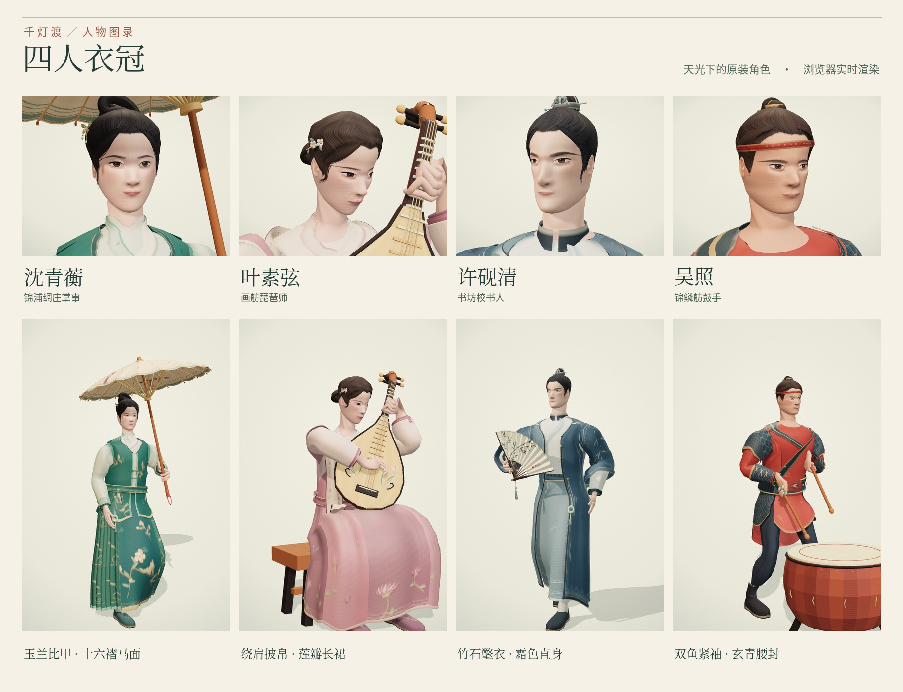
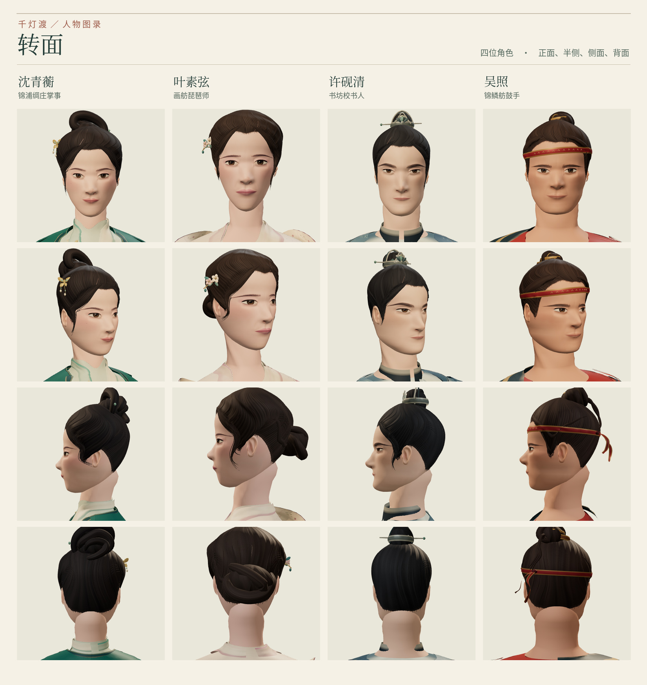
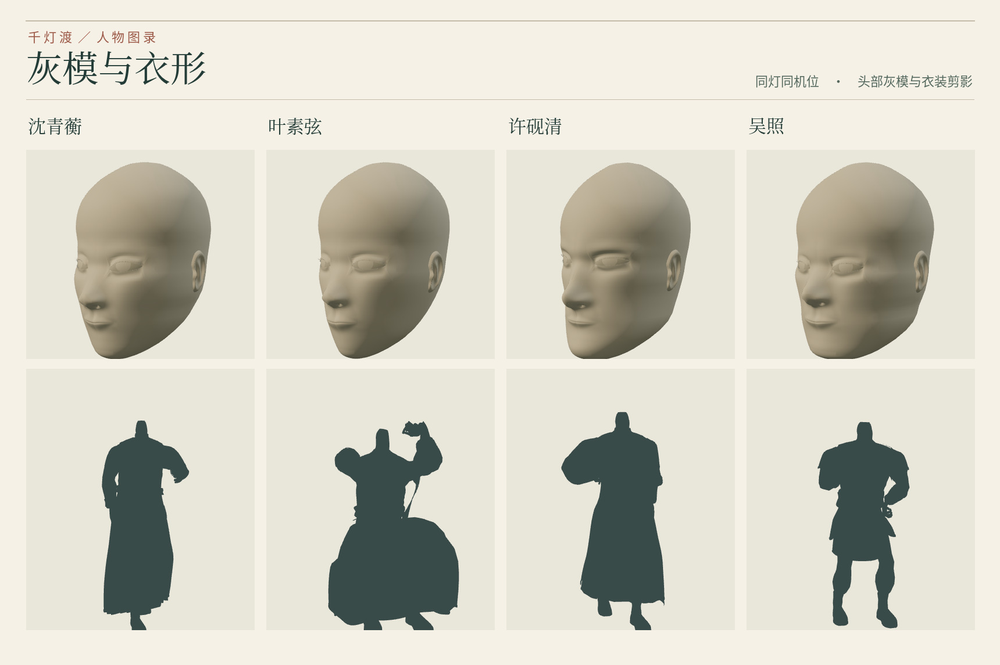
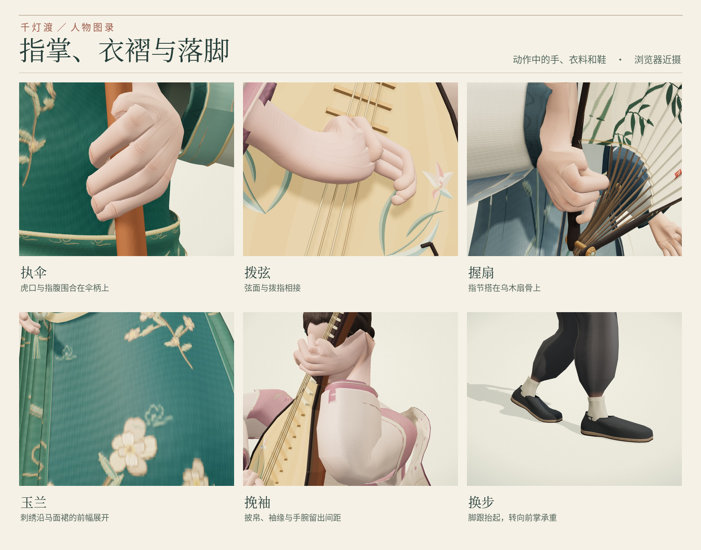
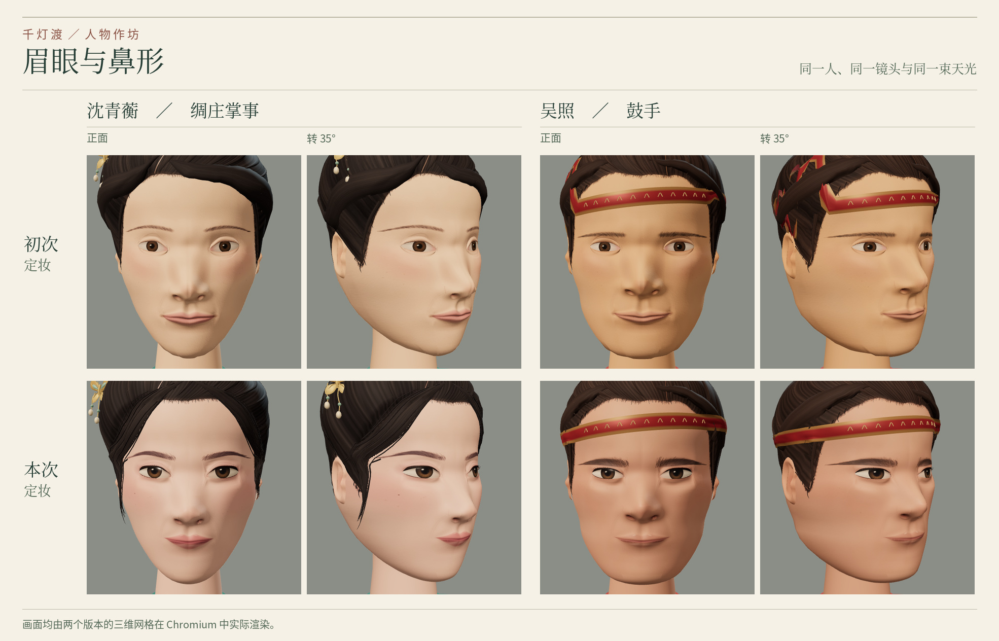

# 千灯渡 · 人物制作手册

人物要经得起三次靠近。隔着一条街，观众应当认得一个人的身量和营生。来到身边，观众应当看得见重量落在哪只脚、哪只手正在做事。再靠近，眼睑、指腹、发根和领缘都要有自己的形体，受光时也应表现出不同的质地。以下图版均由作品中的三维模型在浏览器里实际渲染。

## 从同一个人开始

打开 `studio.html`，第一页是锦浦绸庄掌事沈青蘅。拖动可绕到身后，滚轮或双指收放能拉近。切到「手部」并选左手，可以看她如何握伞。点「暂停」后拖动滑杆，换「天光」与「灯下」会保留动作时刻。展开「造型试样」可以改下颌、梳式、衣款、纹样，点「复原」可对回原样。

图录里选出的十二人都住在城里。「到城中寻访」把镜头带到这位居民身边，此后可以自由飞行。图录中的试装用于比较和导出，街上的本人穿自己的原装。图录用安静的背景及偏侧的照明方便看清形体，镇上的人会受檐影、街灯和手提灯照明。



## 选角与定妆

第一轮把十二人的肩像排在一起，问题才显出来。鼻翼宽窄和年岁已经不同，正脸看去还是相似的眉弓、相似的下巴，在半身照中还共用宽袖交领的轮廓。于是挑出两位女角、两位男角，分别确定他或她吸引人的地方，再把这个决定落实到颅面、肩背、头发、衣装和做事的姿势上。

| 人物 | 脸与身段 | 衣装与行动中的辨识处 |
| --- | --- | --- |
| 沈青蘅，绸庄掌事 | 杏眼、柔和颊肉、圆收的颏尖，肩线轻而利落 | 青绿绸裙与浅金针绣承接纸伞，环髻的饰物从半侧面即可见。 |
| 叶素弦，琵琶师 | 椭圆脸、舒展的眉眼、饱满唇峰，颈肩略向琴弦倾斜 | 藕荷与象牙色叠穿，披帛随肩背转折，为按弦手和琴颈留出空间。 |
| 许砚清，校书人 | 眉骨和长眼有转折，鼻梁清挺，颌线修长，肩背挺拔 | 青黛与霜白叠出纵向长线，执扇的一只手打破了袍服的对称。 |
| 吴照，鼓手 | 中面开阔、直眉、颧弓有力，额角和方收的下颌呼应 | 石榴红、玄青与紧束的袖腕突出开肩击鼓的动作，衣摆容得下重心转换。 |

定妆分两次判断。先在同一镜头和同一侧光下隐去头发、衣服和肤色，比较额角到颧部、鼻尖到嘴唇、下颌到颈部的连续曲线。再拿掉脸和纹样，看衣装正面、侧面与背面的剪影。任何需要看颜色才能分辨的组合，回到轮廓重新裁。任何依靠浓妆才能辨认的脸，回到面部截面重新塑。衣缘粗细、刺绣密度和面部淡染放在最后确定。选色与用线时参考了唐寅笔下衣衫大色块之间的留白。看中年人物眼下与唇周的层次时参考了曾鲸的肖像。[《王蜀宫妓图》](https://www.dpm.org.cn/collection/paint/228271.html) · [《葛震甫像》](https://www.dpm.org.cn/collection/paint/228827.html)



## 定尺寸，再立骨

建模以米为单位，Y 向上，面朝局部 +Z，+X 是人物自己的左侧。中性骨架的脚底在 0 米，踝关节高约 0.09 米，骨盆 0.89 米，肩关节 1.35 米，头部骨点在下巴附近的 1.46 米。基础头壳从颏底至颅顶约 0.233 米。角色可各自改身高、肩宽、胯宽、围度、臂长、腿长。先并排看头身比、肩与头的宽差、肘到腰的位置，然后才穿衣。

22 个关节组成同一骨架。轴向链为根、骨盆、脊柱、胸、颈、头。每侧一条手臂有锁骨、上臂、前臂、手，每侧一条腿有大腿、小腿、足、趾。锁骨带动肩带，膝肘保有弯曲平面，脚尖能在脚跟抬起后继续承重。手指用按工种求出的指节曲线，演奏指法另带可导出的形变目标。

## 塑出能转面的脸

先搭颅后容积和下颌角，再确定颧弓、颏尖与面中部的深浅。把鼻根、鼻尖、鼻下点、内眦、鼻翼外点和口裂定位在同一坐标系里。鼻根到颏底、内眼角间距、左右鼻翼宽以及鼻尖突出量可以直接从 `portraitLandmarks(profile)` 取出，返回值为头部局部米。将它们乘以角色身高系数，再换算为毫米，即是该实例的模型尺寸。

先把女掌事与校书人的正面、三分之二面和严格侧面排在一起。遮住头发，只看两眼之间还容得下多长的一只眼，两边的上睑如何压住虹膜，以及转到侧面后鼻尖、双唇与颏尖的关系。研究国漫造型时，看了《天官赐福》官方人物立绘中眉头至眼尾的用线，也做了原创的男女角色三视图作美术对照。交付物的头形、皮肤、眼睛与发束均由参数、曲线和网格绘制。[动画官方人物资料](https://tgcf-anime.com/chara/) · [中国人群三维面部表型研究](https://www.anthropol.ac.cn/CN/10.16359/j.cnki.cn11-1963/q.2020.0011)

中性头坐标下，沈青蘅两内眼角相距约 31.4 毫米，一只眼裂约 31.4 毫米。许砚清相应约为 32.2 和 32.5 毫米。再往下看，沈青蘅的鼻尖下缘圆收，嘴唇略丰，吴照则有更宽的鼻翼和下颌。两手遮住彩妆仍应保有这些区别。眼距只是绘制的起始参照，最后要在实际灯光中检查露出的眼白、眶周的暗部与目光方向。[沈青蘅与吴照两次定妆的同角度对照](renders/14-眉眼与鼻形改版.jpg)

头壳在两处眼窝开口。上下眼睑共享开口边缘，贴着凸起的眼球滚动。虹膜和透明的角膜另有三维曲面，抬眼或望向琴弦时，从上睑后显露的面积跟着变。眨眼时复查前、侧、斜上三个方向，尤其看近侧的睑缘是否从瞳仁前滑过。鼻下的暗部沿软骨转面生长，侧面看鼻尖到人中应当连续。[Gao 等，眼睑及眶周软组织的三维测量](https://qims.amegroups.org/article/view/132908/html)

面部 1024 × 1024 色图把眉丝、眼窝、颊色、唇色和发根画在对应的头部坐标上。眉头的毛向上长，眉腰后逐渐朝外。唇线在中段最深，下唇中间留一小片柔亮。皮肤和布料分开设置微法线与粗糙度。转到背面，沿鬓角和分缝应当能一路跟到发束的束点。高云髻、低水髻、巾冠和额带各有自己的前后重心。



## 衣料、手和道具一起打样

短褐、褙子、圆领袍、袄裙、长衫、半臂分别裁出衣身、袖筒、领缘和下摆。沈青蘅的内领沿颈侧立起，在胸前交叠后藏进深绿前片。叶素弦的斜襟随坐姿降低，使颈侧与琵琶之间留有清楚的一块空隙。坐姿需要在髋后与膝前分配布量，前屈搬货时要看腰带如何随躯干变形。交领压在里衣上，袖口需要留出腕部前后和拇指根的空间。琴师抬臂按弦时，腕口向后挽出手指的活动范围。观察长袍宜同时开侧面和后面，裙褶只在该放量处展开。

先用经纬方向和明暗画出布料组织，再让竹叶、折梅、云水纹沿局部裁片走。图录的素织选项可单独看剪裁。麻布保留较宽的漫反射，暗花绫和滚边有较集中的高光，并随经纬法线改变。看衣褶时借鉴了《韩熙载夜宴图》里琵琶手双臂的高低、坐者膝上的布量与袍服大色块之间的关系。作品的图像只用于观察。[故宫博物院藏《韩熙载夜宴图》](https://www.dpm.org.cn/collection/paint/228200.html)

手掌有指根弓、鱼际与虎口，四指各自使用不同的三节长度，拇指跨掌与其对握。先确定道具的局部接触点和轴，再让腕、肘、锁骨联动到这个位置。以伞为例，虎口围住伞杆，四指指腹贴圆杆，腕保有小角度。转到伞骨一侧还要看另一只手如何自然摆动。拨弦检查指腹和弦，吹笛检查吹孔与唇、指孔与指腹，击鼓逐帧看槌头何时到达鼓皮。掌纹、甲床、指节和手背肌腱另用 1024 × 512 的分区图表达。



## 让动作从支撑处开始

行人一脚着地时，用该步的实际路线和世界坐标求支撑点，换脚才移走它。脚跟先触地，重心经过前掌时脚跟翻起，脚尖离地后膝部抬起。步长随腿长与路线速度变化，胸廓和骨盆轻微反扭，摆臂与对侧腿呼应。在码头压条、石砖和高台街道，用真实地面采样校正鞋底。图录和导出的步态在原地完成，接入游戏的角色控制器时，位移应随移动速度另行提供。

先有船的真实坐板和桨栓，才安排坐骨与桨手腕位。船体颠簸跟着船走，桨以桨栓为枢轴，双手去找转动中的柄。琴凳、鼓皮、车上的货堆也用同一原则。倒拖时间条能发现依赖上一帧而漂移的手或衣摆。为下一个职业设计动作，应先画出承重物、接触点、施力方向和两极姿势，再做中间帧。

## 添加一个人物，保留已有衣柜

下例在现有源码中建立一个新角色样件。`characterProfile` 的整数编号决定稳定的面部、肤色和体量。分开改脸、衣服与发型，可以在同一灯光、同一时刻检验每个决定。此例导出一个可在独立查看器打开的 GLB。

```js
import { characterProfile, characterVariant } from './src/characterProfiles.js'
import { exportCharacterGLB } from './src/exportCharacter.js'

const original = characterProfile(120, 'basket')
const sitter = characterVariant(original, {
  jaw: -0.38, hair: 'braid', garment: 'beizi', pattern: 'plum',
})
sitter.name = '沈映竹'
sitter.face.nose = 0.21
sitter.colors.outer = 0x617f76
const bytes = await exportCharacterGLB(sitter, 'basket', { walking: true, phase: 0 })
const file = new Blob([bytes], { type: 'model/gltf-binary' })
```

这段代码通过项目的 ES 模块构建后在浏览器执行。若要把样件安排到街上，为对应的船、码头或街坊路线提供唯一的 `appearance` 编号、工种、位置、朝向与尺寸，再在 `characterProfiles.js` 的人物档案中登记相同编号和造型。`characterCast.js` 管上河与码头，`reachPeople.js` 管山街。图录中的人物表与实际路线共用编号，换景和切换细节时能找到同一个人。完成新工种后，把同一套姿势交给图录与城区运行一遍。

## 导出与验收

在「造型试样」内选「导出 GLB」可下载当前造型。文件内含几何、骨架、蒙皮、材质、图像、所用器物和该职业的循环动作。游戏引擎可以直接播放烘焙后的动作，DCC 工具可以继续调整骨骼。动作为每秒 24 次取样的关节、道具与形变权重，保留局部四元数旋转和以米表示的位置。文件还带一段约 0.23 秒的独立眨眼，游戏可以自行安排它的播放时机。手指指法用具名形变，人体骨架支持身体动作重定向。

| 检查位置 | 本轮发现与处理 |
| --- | --- |
| 正脸、侧脸与后脑 | 重构内眦到眶缘的深浅、鼻基底、唇体和耳根，用完整闭眼与侧面遮挡检查眼睑，沿发际和分缝重梳发束。 |
| 衣领、曲肘、坐膝 | 连通锁骨至下颌的颈面。重裁坐姿袍摆、里裤与袖口，在琴师和搬运人身上分别试穿六款衣服。 |
| 握扇的虎口 | 书生转腕时，虎口露出一小块青色衣料。沿近摄镜头追踪到掌网格，把拇指根的两圈网格接回鱼际，再从相同方向检查导出的手。 |
| 琵琶与拨弦手 | 正面近摄曾只看得见指尖。按闭合音箱的外缘布置肘、腕，让琴底落在腿上的裙褶处。逐帧复核右手的拇指和食指轮流拨弦、左手食指按弦与拇指托颈。 |
| 袖内露出的手腕 | 从侧面靠近，手掌与前臂相叠的地方出现浅色月牙。两段皮肤共用同一圈边界，沿着腕骨转折衔接肤色与法线，再分别看拨弦、执扇和空手的腕部。 |
| 足底与其他器具 | 复核伞杆、笛孔、鼓面和货筐。用真实鞋底的跟、掌、趾检查整步，并在地砖压条处复查。 |
| 船上动作空间 | 调整真实坐板、桨孔和篷灯。用船员头发、脸、耳与船体逐三角检查，桨划到两端也要留出净空。 |
| 游戏文件 | 从图录下载四位主角原装、改装与巡更人，重新载入四位原装，对照脸、手与道具的姿势，用 Khronos glTF Validator 校验。 |

在 Godot 中把 GLB 作为三维场景打开，选 `AnimationPlayer` 播放带人物名字的职业动作。单独播放「眨眼」可以检查上下眼睑合拢。Blender 从「导入 → glTF 2.0」读取同一文件，能分别选中人体骨架、蒙皮衣片、持物和带形态键的网格。纹理封装在 GLB 内。

源目录执行 `npm ci`、`npm test`、`npm run build` 可以重建两份入口。`python test/character_studio.py --url http://localhost:4173/studio.html` 可重走选人、试样、旋转、暂停、换灯、下载以及两种手机视口。测试使用 Python Playwright 和 Chromium。

衣物随骨架与坐、立裁片变形，头发使用梳定的发束。极端自定义动作需要追加修形，长发与衣摆在强风中的摆动需要另行制作。面部提供目光与眨眼，配音对白需要口型系统。城市会按屏幕中人物的大小切换细节，贴近查看或导出时使用完整模型。

## 两次定妆的同机位复核

沈青蘅初版的眼球几乎整圈露在睑缘里，鼻尖下还有两块界限很硬的暗部。第二次定妆压低上睑，收拢内眦与鼻根之间的距离，把鼻下阴影接回上唇。转过 35°，近侧鼻翼仍然能读出厚度，近眼、鼻梁与远眼之间也有了前后层次。

吴照保留了较宽的鼻翼、方收的下颌和较低的眉骨。把两人的新脸并排看，掌事的眉尾和唇峰较轻，鼓手的眉腰与颧部转折更清楚。先在这个角度锁住姿势、曝光和焦距，再进城看檐下的暖光如何越过眉弓和鼻梁。


